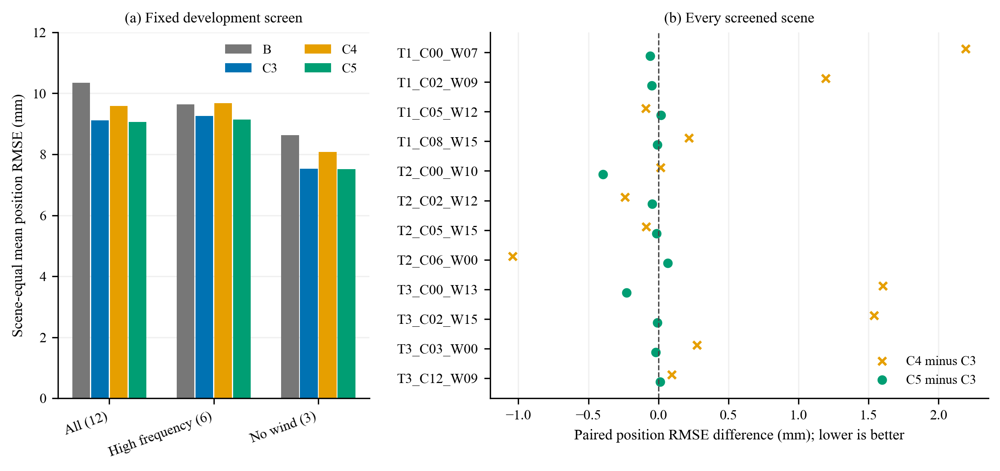

# C5 固定12场主审结论

**决定：机制筛查通过，批准隔离实现补齐DEV72；尚未达到论文证据包验收。**

主模型实际读取12个C5 raw并独立复算全部23,616个有效事件，更新/输出/时间窗/混合参考/实际力链/cfg/opts/source均通过；最大数值差为 5.211e-13。B来自已审新可追溯B72，物理输入一致；原C3与C4结果合法复用。

唯一改动是固定 M=diag(1,1,0)：水平保留C3残差坐标，Z使用请求坐标；同编码器与同一个33×3头，不拼接B或不同运行的轴。0训练、0新B、0TEST。

| 组（场景等权） | n | B Q/mm | C3 Q/mm | C4 Q/mm | C5 Q/mm | C5胜B |
|---|---:|---:|---:|---:|---:|---:|
| ALL12 | 12 | 10.349102 | 9.116291 | 9.589832 | 9.055650 | 10 |
| HF6 | 6 | 9.632957 | 9.253685 | 9.684147 | 9.139203 | 4 |
| W15 | 3 | 8.628703 | 7.526220 | 8.083008 | 7.516900 | 3 |
| T1 | 4 | 11.148094 | 9.399590 | 10.278561 | 9.376072 | 4 |
| T2 | 4 | 10.224844 | 9.368590 | 9.030752 | 9.271012 | 3 |
| T3 | 4 | 9.674368 | 8.580694 | 9.460184 | 8.519865 | 3 |

五个预登记门全部通过：两个FIG8高频场Q与Z均低于C3、全12平均Q不高于C3、高频6场/无风3场平均Q不高于B、所有场完整安全。C5有9/12场Q低于C3，3场略升；胜B仍为10/12，改善>1µm及>10µm也均为10/12。不能把筛查通过写成DEV72或独立TEST通过。

## 全部输场（未舍入值判定）

| 场景 | B Q/mm | C3 Q/mm | C5 Q/mm | C5−B/mm |
|---|---:|---:|---:|---:|
| DL1018_VAL_T2_C00_W10 | 8.516659 | 9.165824 | 8.768693 | +0.252034 |
| DL1018_VAL_T3_C00_W13 | 7.372254 | 8.441649 | 8.213274 | +0.841020 |

## 逐轴、阶段与安全

下表均为场景等权均值；完整逐场原精度数据见 `screen12_parent_review/ALL48_METRICS.csv`，配对表及所有输场另存CSV。

| 方法 | X/mm | Y/mm | Z/mm | 0–5s Q/mm | 5–20s Q/mm | 峰值/mm | P95/mm |
|---|---:|---:|---:|---:|---:|---:|---:|
| B | 6.689880 | 6.961747 | 1.843254 | 11.592434 | 9.163755 | 37.972571 | 21.000620 |
| C3 | 6.025249 | 5.977907 | 1.946258 | 11.631340 | 7.298223 | 29.955975 | 20.759734 |
| C4 | 6.586095 | 6.506908 | 1.677728 | 11.251821 | 8.580753 | 27.764300 | 17.879498 |
| C5 | 6.024403 | 5.975960 | 1.679371 | 11.620109 | 7.148624 | 29.951549 | 20.781566 |

所有C5场完整STABLE，20,000转移/20,001状态，电机饱和与广义控制限幅比例均为0。20,000个位置计分点保持原规则。控制耗时已在完整表保留，但未作正式隔离耗时测量，不得当成正式实时性验证。

## 证据边界与下一步

C4全轴切换已被原门否决；C5在相同场景上改善了主要Z问题，保留了水平补偿，但这不证明任意轨迹/跨种子或整个高频组都胜B。尤其两个输场仍须在完整开发表中保留。下一步只补原72集合的其余60场，不换模型、参数、场景或评分门。只有完整开发性能、贡献、理论及消融分别通过，才考虑一次封存TEST48。

本轮尾批v1因入口从错误JSON对象读取snapshot字段而在Plant前自然OS1，0新航次；主模型承担漏检。v1全部保留，v2仅改正确字段来源及尾批版本文件名，实际字段逐层核验通过后，11场一次执行自然OS0、无重试。整个续作累计完成96航次（B1+C4×12+B71+C5×12），0训练/0TEST。

理论方面：负延迟方向记忆储能在理想子情形经精确有理数和主模型独立排列行列式复算，固定余量4e-5成立；实际扰动后验界已给出，但依赖路径项，部署理论门仍未通过。此前执行者曾报告未落盘的peer SHA，该值已拒绝；现有真实peer文件SHA为26da62efca936730497cd39319ccdfa2614019e618b4fba24c8b4f062f4f4bf6。



图为固定开发筛查，未作独立测试或统计总体泛化声称。图脚本和PDF/PNG均已保存并视觉核验。

## 复算命令与输入身份

```powershell
python 'reports/paper_continuation_20261023/c5_axis_coordinate_parent_review/score_c5_screen12_parent.py'
```

上述脚本真实退出0。原输出目录存在时会拒绝覆盖；重做只读审计应保留原证据并在新版本输出目录进行。

主审SUMMARY SHA-256：`fe217ac8b259706b1953e07dd44586b6a64368a6d4f5e0145e8f507863d82ad8`。尾批v2 release SHA：`4f6dc42467bc0ea5acd0b392d1d947f81f5bc4f4bf52d2e9933564de759b49a3`。
